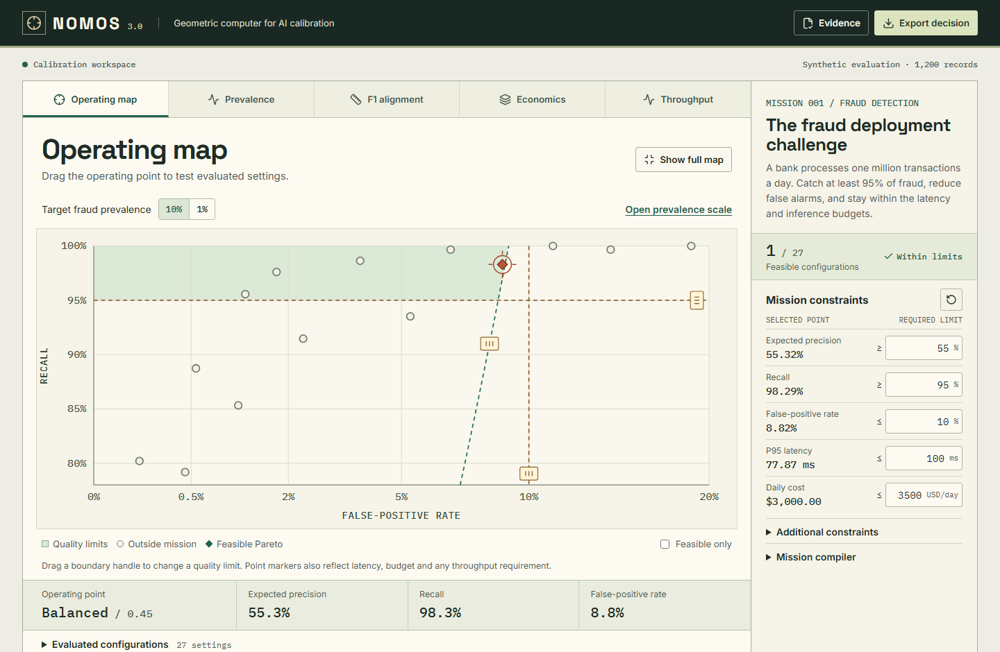

# NOMOS 3.0

NOMOS is a geometric computer for AI calibration. It opens with a fraud deployment mission and a map of evaluated model thresholds. Drag the operating point and quality boundaries, change the target fraud prevalence, verify the connected geometric readings, and export the decision.



## Run locally

Node 24 and Python 3.11 are used for the project's verification workflow.

```sh
npm ci
npm run dev
```

Open the local URL printed by Vite. For a production run, use `npm run build` and `npm start`, then open `http://127.0.0.1:4173`. The built `dist/` directory also works on a static host. The container path is `docker compose up --build`.

## Work the mission

- Drag a point or choose an evaluated threshold from the configuration table. Drag the recall, precision and false-positive boundaries, or edit their exact limits in the rail.
- Switch from 10% to 1% prevalence and watch expected precision and feasible candidates change. Open the prevalence plate to operate the log-odds straightedge.
- Use F1 for the harmonic mean, Economics for daily cost, and Throughput for Little's Law. Independent practice inputs are available for F1, Economics and Throughput.
- Open Evidence for numerical checks and dataset provenance. Export the selected decision as JSON or YAML.

The fixture evaluates synthetic classification scores for 27 thresholds. P95 uses simulated timing, prices are declared assumptions, and measured throughput and capacity are unknown. Prior adjustment assumes that conditional TPR and FPR remain applicable in the target population.

## Verify

```sh
npx playwright install chromium
npm run check
```

The command checks the regenerated evidence, lint, TypeScript, Vitest, production build and Chromium journeys. To regenerate the bundled evidence, run `npm run data:generate`.

The offline mission compiler works after installation without an external account. To enable the optional model-assisted parser, copy `.env.example` to `.env` and set `NOMOS_LLM_API_KEY` and `NOMOS_LLM_MODEL`. The server can use an optional OpenAI-compatible endpoint. Review the proposed limits before applying them.

## Documentation

- [Demo walkthrough](docs/NOMOS_V3_DEMO.md)
- [Architecture and dependency graph](docs/NOMOS_V3_ARCHITECTURE.md)
- [Nomogram derivations](docs/NOMOGRAM_MATHEMATICS.md)
- [V2 audit and migration plan](docs/NOMOS_V3_AUDIT.md)
- [Verification report](docs/NOMOS_V3_TEST_REPORT.md)
