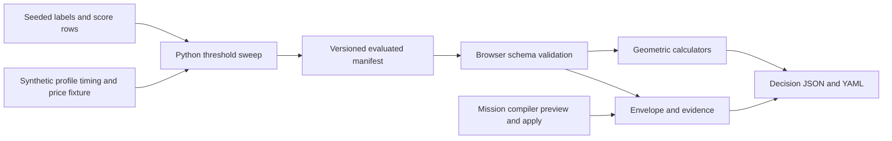

# Architecture

`src/core/geometry.ts` stores calibrated transforms, straightedge intersection and inverse transforms. `src/core/instruments.ts` adds domain states and a separate arithmetic verifier. The reusable SVG draws the exact returned coordinates and uses the inverse SVG screen matrix for pointer manipulation. The workbench verifies its finite readings and makes the coordinates and numerical error available on demand.

The evaluation manifest loads with the bundle. Browser code checks constraints, finds both Pareto frontiers, ranks candidates and exports paired files with the same decision identifier. These functions are the application equivalents of the PRD's logical envelope and export APIs. [The standalone Node server](../server/start.mjs) serves the built bundle and exposes only the optional parser endpoint. The same parser middleware is available during Vite development. Static hosts use the offline grammar directly when the provider endpoint is unavailable.

The map projects latency and recall. Its crosshair snaps to evaluated points and the point color includes all four gates. The data table indexes all candidates, including overlapping coordinates. The threshold slider steps through the selected model's manifest rows.
