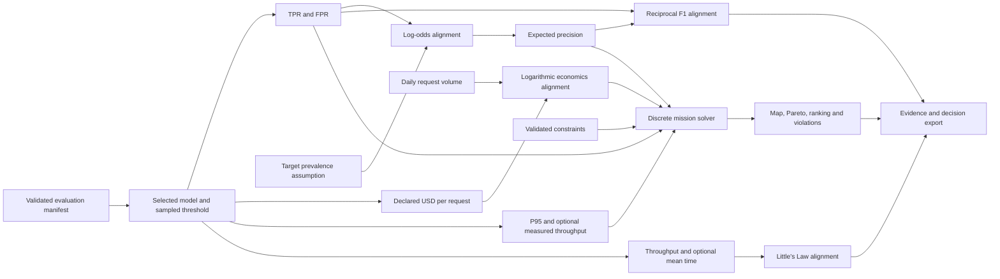

# NOMOS 3.0 architecture

The app runs locally with React and Vite. The Python evaluator and the version 2 evidence contract remain compatible with the original fixture. Production can run with Node's static server and optional mission parser route, or with any static host and the browser parser.

## Dependency graph

- [Geometry](../src/core/geometry.ts) owns calibration, inversion and straightedge intersection. [Instrument adapters](../src/core/deployment.ts) select calibration, handle boundaries and assemble the dependency chain. [Reference arithmetic](../src/core/reference.ts) verifies the reading independently.
- [Feasibility](../src/core/envelope.ts) evaluates active gates for each candidate ID under the same mission and request volume. Missing required values prevent a verified pass. Checks allow a few units in the last place for scale rounding. Pareto comparisons are strict, require complete comparable values, and use the active axes of the mission. Ranking changes the recommended candidate without replacing the current selection.
- [The map](../src/components/Envelope.tsx) plots sampled TPR and FPR with square-root spacing on the FPR axis. Shading shows the analytic intersection of quality limits. Markers encode the full discrete solver including budget, P95 and optional throughput. Candidate drag snaps to the closest plotted sample in view coordinates. Exact edits and a table offer keyboard access and reach points outside the focused viewport.
- [The workspace](../src/App.tsx) owns mission, selected candidate, request count and ranking. Instrument practice state stays local and survives switching plates. SVG drags use inverse screen coordinates and pointer capture. The straightedge freezes scale calibration during a grab and applies the latest motion once per animation frame.
- [Mission parsing](../src/core/mission.ts) uses a deterministic grammar and an optional [server provider](../server/mission.mjs). Proposals require explicit application. Unrecognized limits or unresolved provider clauses are shown for clarification. The solver consumes validated numbers, independently of the parser.
- [Exports](../src/core/export.ts) share one decision record across JSON and YAML. Version 3 adds target prevalence, daily volume, derived results, the applicable gates, and complete verification metadata. Source precision and its Wilson interval remain tied to the source distribution. The old call shape without a target prevalence still exports version 2 economics with monthly units.

## Evidence and limits

The app evaluates bundled synthetic model scores. P95 derives from synthetic profile timing, and cost uses a stipulated price. Feasible means that a sampled configuration meets the current scenario under those inputs. There are no measured throughput or mean response times in the fixture. The optional performance record can carry those values and their provenance, and only measured throughput satisfies a throughput requirement. Capacity stays unknown without a separate saturation experiment.

No interpolation, online model training, or production deployment takes place. The browser requires modern Pointer Events, SVG and Web Crypto. Provider tests use a local stub. The optional provider receives mission text and current constraints, while the evaluation remains local.
