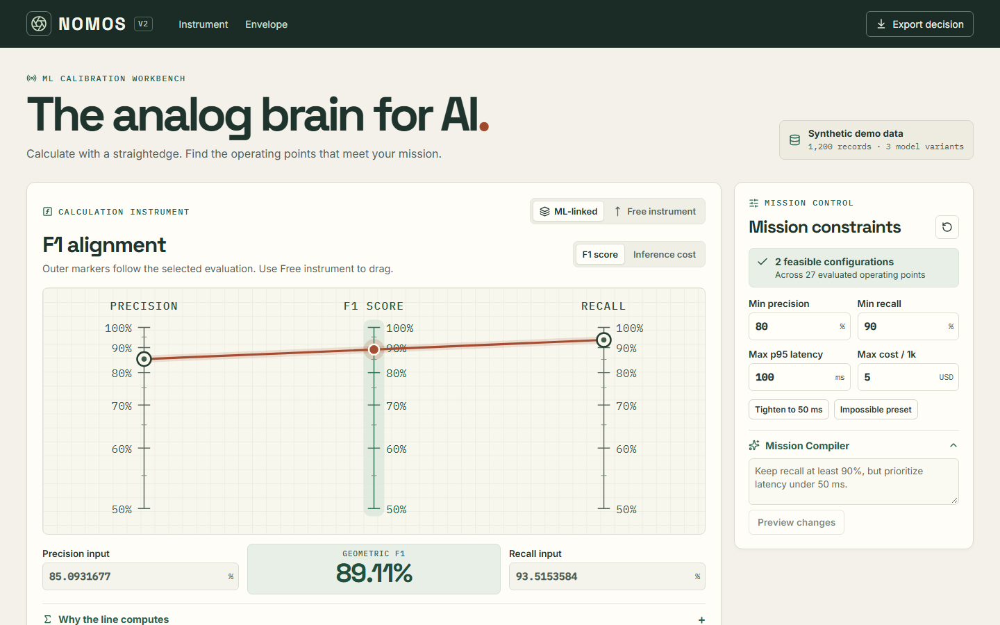
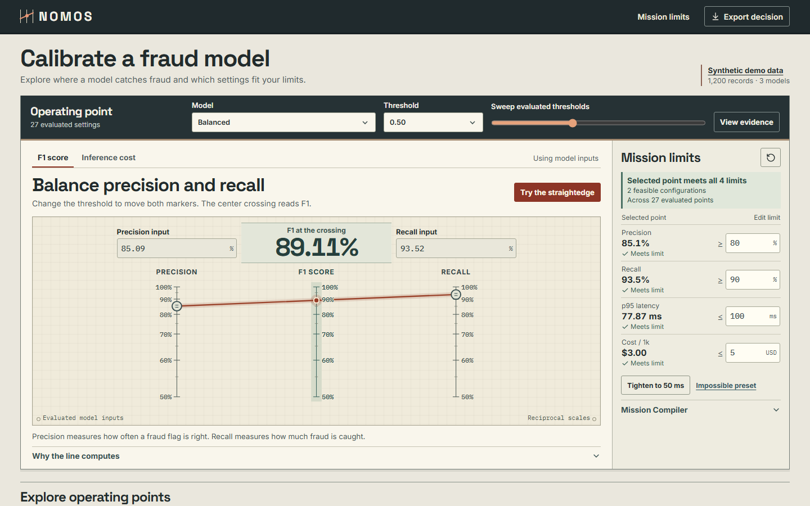

# NOMOS UX redesign report

## Problems discovered

The original interface put the model and threshold below the first screen, even though they drove the top chart. Status for the selected point, dataset-wide feasibility and available alternatives appeared in different sections. The phone rendered the entire desktop SVG at 125 px high, shrinking labels and hit targets. The baseline browser journeys also reproduced a pointer jump, stale mission compiler feedback, lost dialog focus and ambiguous practice-mode exports. The [UX audit](UX_AUDIT.md) records each reproduction, severity and acceptance check.

## Bugs fixed

| Finding | Fix and verification |
| --- | --- |
| Off-center drag changed precision on horizontal movement | Pointer capture preserves the initial vertical grab offset. The inverse screen matrix maps subsequent screen coordinates back to the SVG. Browser tests cover an off-center grab, live motion, 125% CSS zoom, a viewport resize during capture and mobile touch. |
| Nearby Pareto points could all disappear | Pareto comparison uses exact objective directions. Mission limits preserve their inclusive tolerance. A regression reproduces the former three-point cycle and verifies the corrected frontier. |
| A positive cost tick printed as zero | Small positive currency ticks use explicit notation. Browser tests check large request volume and zero-boundary behavior. The zero cost handle sits beyond the low end of the plotted logarithmic scale. |
| Mission fields applied each prefix and stale requests surfaced errors | Numerical edits commit on Enter or blur, and Escape cancels. Parser results belong to the submitted text and mission snapshot. Tests cover the four limit fields, the delayed response, rejected text, explicit apply and repeated reset. |
| A failed manifest import produced a blank page | The startup path validates and shows a recovery message. Browser tests exercise a malformed manifest, an empty evaluation and a selected point with missing latency. |
| Closing evidence lost keyboard focus and the map had 27 tab stops | The shared dialog returns focus to its opener. Map focus follows the selected candidate with arrow keys and exposes an accessible data table. Browser tests exercise both. |
| Practice inputs made exports ambiguous | The export summary states the evaluated point and linked volume. Browser tests parse both downloads, exercise practice vs linked inputs, and verify recovery from a failed download preparation. |

## UX and design decisions

- **One workbench.** The dark setup strip places the model, evaluated threshold, scrubber and evidence above the chart. Four measured values and their editable mission limits sit alongside it. The map offers exploration farther down the same workspace and shows the current selection.
- **Learn through a grab.** Model inputs appear on arrival. **Try the straightedge** releases the practice handles, with a keyboard shortcut path into the first handle. The line and its crossing move together. Returning to model inputs restores the selected candidate. Practice can be reset independently.
- **Explain the consequence.** A threshold move produces signed changes in precision, recall and F1. Every failed mission row names the metric and size of the miss. The 50 ms preset takes the demo from two feasible points to zero and exposes the nearest evaluated setting and needed limit.
- **Make proof accessible.** The etched scales and copper straightedge are the primary visual device. The historical graphical method, formula, coordinates and reference error are progressively disclosed. The empirical operating-point map uses check marks and a selection ring in addition to color.
- **Design the phone scale independently.** The phone uses an equally spaced set of horizontal axis positions with the same calibrated vertical range. In the 390px capture the chart grows from 125px to 265px high. The model picker starts at y=221 instead of y=946. On desktop the picker moves from y=1,061 to y=200.
- **Preserve work during exploration.** The decision artifact identifies the selected evaluation and uses canonical model coordinates for the geometric proof. The linked request volume drives its cost. Practice inputs have their own reset. Exports include hashes, constraint results and independent reference checks.

## Components changed

| Area | Source |
| --- | --- |
| Workspace, dataset inspector, selection history and export | [App](../src/App.tsx), [startup](../src/main.tsx), [export](../src/core/export.ts) |
| Nomogram controls, range adaptation, responsive geometry and drag lifecycle | [InstrumentPanel](../src/components/InstrumentPanel.tsx), [AlignmentNomogram](../src/components/AlignmentNomogram.tsx), [instruments](../src/core/instruments.ts) |
| Limits register, edit validation and compiler feedback | [MissionPanel](../src/components/MissionPanel.tsx), [NumberField](../src/components/NumberField.tsx) |
| Dataset and evidence drawers, point comparison, chart keyboard navigation and exact Pareto comparisons | [Drawer](../src/components/Drawer.tsx), [Evidence](../src/components/Evidence.tsx), [Envelope](../src/components/Envelope.tsx), [envelope solver](../src/core/envelope.ts) |
| Workbench visual system and reduced motion | [Styles](../src/styles.css) |

Pointer processing is coalesced to animation frames and static SVG scales are memoized. Export code loads on demand. The production entry JavaScript measured 117.40 kB gzip, down from 131.98 kB. The export chunk measured 17.41 kB gzip. These are bundle sizes from Vite output.

## Verification

`npm run check` passed byte-for-byte dataset regeneration, ESLint, TypeScript, 35 Vitest tests, the production build and 11 Playwright tests against the production server. Both geometric methods are compared with independent arithmetic. The expanded property checks include 1,000 F1 cases across twelve orders of magnitude and 1,000 cost cases across the supported price and request ranges. The tests inspect the straightedge crossing, boundary cases, scale calibration and reference agreement.

Chromium exercised offline preview and apply, candidate switching and evidence, the four mission limits, keyboard and touch manipulation, mid-drag resize, reduced-motion layouts, browser Back and Forward, and parsed JSON/YAML downloads. The axe-core scans found zero violations for the configured WCAG 2.0 and 2.1 A/AA rules on the desktop and phone first views. The two instrument screenshot baselines passed against the production build.

## Screenshots

| View | Before | After |
| --- | --- | --- |
| Desktop · 1440 × 900 | [Before](ux-screenshots/before-desktop.png) | [After](ux-screenshots/after-desktop.png) |
| Tablet · 820 × 960 | [Before](ux-screenshots/before-tablet.png) | [After](ux-screenshots/after-tablet.png) |
| Phone · 390 × 844 | [Before](ux-screenshots/before-mobile.png) | [After](ux-screenshots/after-mobile.png) |
| Latency preset with zero feasible points |  | [Full workspace](ux-screenshots/after-mission.png) |
| Cost nomogram with numerical proof |  | [Full workspace](ux-screenshots/after-cost-proof.png) |

### Desktop before



### Desktop after



## Remaining limitations

The evaluation covers one bundled synthetic dataset. Timing samples are simulated and costs are estimated from declared rates. Overlapping points in the two-dimensional map can be selected individually with the threshold control, keyboard navigation or data table.

Verification used Chromium on Windows, including emulated mobile touch. Live provider, Docker, Firefox, Safari and manual screen-reader sessions remain unverified. The first-visit assessment was an audit walkthrough.

## Run

In the project directory, use Node.js 24 and run the following commands.

```sh
npm ci
npm run dev
```

Open http://127.0.0.1:5173. Use **Try the straightedge**, then select **Tighten to 50 ms** to see how the limits affect the evaluated points. For the production server, run `npm run build` and `npm start`, then open http://127.0.0.1:4173. The optional provider uses the environment settings documented in the [README](../README.md).
